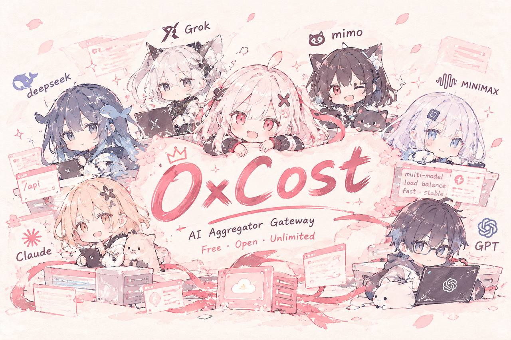

# OxCost

**OxCost is an AI gateway — an aggregator gateway framework.**

---

One entry point, many models behind it. OxCost routes requests across multiple
AI providers and models with load balancing — fast and stable.

- **Multi-model** — aggregate many upstream models behind one API
- **Load balancing** — distribute traffic across providers and channels
- **Fast · Stable** — built for always-on serving

## License

This project is licensed under the **[GNU Affero General Public License v3.0](LICENSE) (AGPL-3.0)**.

Free for personal and non-commercial use. **Any commercial use requires the
derived/modified source code to be released as open source under the same
AGPL-3.0 license.** Closed-source commercial use is not permitted.

---

[Telegram channel](https://t.me/sliverkiss_blog)

