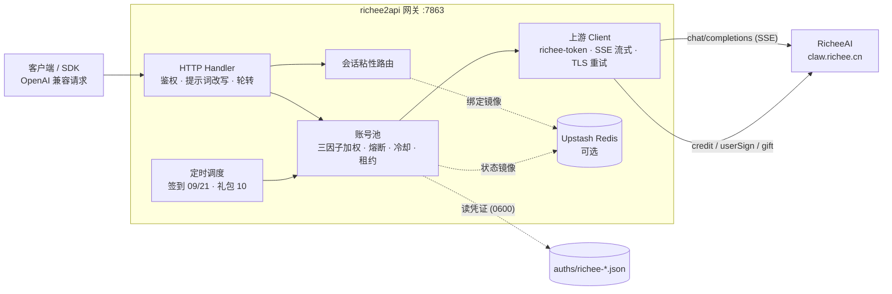

<p align="center">
  <b>richee2api</b><br>
  <b>把 RicheeAI（睿契）账号变成 OpenAI 兼容 API 的多账号网关</b><br>
  SMS 登录 · 账号池轮转 · 熔断与冷却 · 会话粘性 · 积分签到
</p>

---

## 项目简介

richee2api 是一个自托管的 **OpenAI 兼容上游网关**，将 RicheeAI 账号包装为统一的 `/v1/chat/completions` 服务。

本项目是 [workbuddy2api](https://github.com/Sliverkiss/workbuddy2api)（MIT）的移植：把上游从 CodeBuddy 换成 RicheeAI，登录从 OAuth 设备授权换成手机号短信验证码。上游协议事实见 `docs/SPEC.md`，移植偏差逐条记录在 `docs/PORT_NOTES.md`。

### 本项目做什么

- 通过 **短信验证码登录**（`./login.sh`）获取账号凭证（单个 `richee-token`，不过期），在网关侧做账号池调度与流量治理；
- 面向 **个人多账号** 场景：多账号共享、单号故障自动换号、冷却 / 熔断防止雪崩、会话粘性保证多轮上下文不跳号；
- 对客户端只暴露 OpenAI 兼容接口，现有 SDK / 前端 / 工具 **零改造接入**；思维链（`reasoning_content`）随 SSE 透传。

### 本项目不做什么

- **只做上游网关，不做下游协议转换** — 仅对接 RicheeAI 并暴露 OpenAI Chat 协议；
- **不内嵌 Web 管理面板** — 网关核心保持精简。

> ⚠️ 合规须知：本项目是**非官方**网关，使用 RicheeAI 账号作为上游，**仅限本人授权账号、本机 / 私有环境测试**。

## 核心能力

### 账号池治理

- **短信验证码登录** — `./login.sh` 一条命令完成：发码 → 输入验证码 → 登录 → 凭证落盘 → 重启加载，重复执行即可连续添加多账号（每手机号每天前 3 次发码免人机验证）
- **三因子加权随机选号** — `credits 比例 ×10 + 快过期积分占比 ×8 + 闲置补偿` 加权（`pool.expiring_soon` 窗口内的积分优先消耗，默认 7 天），Top-5 候选短名单内加权抽签；失败账号由熔断 / 冷却 / 连败降权状态机处置
- **防惊群** — 跳过 100ms 内刚被选中的账号
- **在途租约** — 单账号最大在途请求数（`pool.max_in_flight`）限制并发占用
- **账本择优** — 每次成功请求按 usage 折算单价记入 `(账号, 模型)` 账本，免费 / 便宜的账号优先；账本随池状态落盘 `state.json`
- **成本分层条件探索** — costTier 硬过滤会把全池锁死在唯一免费号上；`pool.cost_explore_interval`（默认 30m）窗口到期就把选号改道给未知号，成功即毕业、失败走既有冷却，零新增上游请求

### 流量治理

- **分级熔断与冷却** — 429 软冷却（600s 起指数退避、封顶 `soft_rate_max`）、404 固定浅冷却、余额耗尽硬冷却至次日 04:00、连续失败熔断（`breaker_threshold` 触发后指数退避封顶 6h）
- **账号临时停用 / 恢复** — `manual_disabled` 与 `disabled` 双独立状态位；停用期间签到照常执行。入口：`/admin/accounts/{uid}/{disable,enable,revive}` + `./acct.sh`（默认关闭，`admin.enabled` 显式开启）
- **状态持久化** — 池状态本地原子落盘 `state.json`，可选镜像至 Upstash Redis，重启择优恢复
- **token 失效治理** — RicheeAI token 不过期（`expireAt:null`）；服务端撤销表现为业务 code 401，连续 3 次后禁用账号（防单次抖动误杀），恢复需重新 `./login.sh`

### 请求链路

- **流式 + 非流式** — 出站强制 `stream:true`；SSE 帧按 OpenAI 规范白名单重建（含 `delta.reasoning_content`）；非流式由本地聚合为单响应
- **出站改写管线** — `max_completion_tokens` 别名翻译、tool_choice/image_url/developer 角色归一、tool_call↔tool 配对清理（会话自愈）、指纹脱敏（可开关）
- **系统提示词三模式**（`prompt.mode`）— `passthrough`（缺省，透传 + 拦截降级）/ `custom`（替换）/ `append`（两者并用）
- **TLS 握手重试** — 上游 TLS 偶发超时，短 RPC 传输层 3 次退避重试

### 选号语义

选号 = 会话粘性（命中即定）→ 成本分层（硬过滤）→ 加权随机（软均衡）三层串联。粘性键优先级：conversation 维度键 → `prompt_cache_key` → 首条 user 消息哈希兜底；绑定 30 分钟滚动续期。

### 定时任务

- **签到**（09 / 21 点）— 每日签到 + 积分查询，余额恢复自动解冻冷却账号
- **礼包**（10 点）— 新用户礼包幂等领取

## 架构总览



## 快速开始

### 环境要求

- **Docker + Docker Compose**（推荐）或宿主机 Go ≥ 1.22
- 一个或多个已注册的 RicheeAI 账号（手机号）

### Docker Compose 一键部署

```bash
git clone <this repo> richee2api
cd richee2api
cp config.example.json config.json
```

编辑 `config.json`，**至少设置 `api_key`**（留空 = 不鉴权，公网部署务必设置）。

```bash
# 登录添加账号（重复执行可加多号）
./login.sh

# 启动服务
docker compose up -d --build

# 健康检查（无可用账号时 503）；service 字段用于确认打到的是本网关
curl -s http://localhost:7863/healthz
```

`login.sh` 内置发码 + 登录 + `auths/richee-<uid>.json` 落盘 + 容器重启，账号池在容器启动时用 `auths/` 目录自动对齐，新增凭证文件即自动发现。

> **非 root 宿主用户注意**：`./login.sh` 以当前宿主用户落盘凭证（0600），容器内网关以 `app(uid 10001)` 读取。uid 不同时容器读不到凭证文件，`/status` 账号数为 0。登录后把目录属主交给 10001：
>
> ```bash
> chown -R 10001:10001 ./auths
> ```
>
> 之后新增账号建议进**容器内**登录（属主自动正确）：
>
> ```bash
> docker compose exec -it r2api bash -c './login.sh' && docker compose restart r2api
> ```

### 源码构建

```bash
go build ./...
go vet ./...
go test ./...      # 完整测试套件
go run ./cmd/server -config config.json
# 或开发模式（前台运行）：
./dev.sh
```

构建二进制：

```bash
CGO_ENABLED=0 go build -trimpath -ldflags="-s -w" -o r2api ./cmd/server
CGO_ENABLED=0 go build -trimpath -ldflags="-s -w" -o signin_bin ./cmd/signin
CGO_ENABLED=0 go build -trimpath -ldflags="-s -w" -o login_bin ./cmd/login
CGO_ENABLED=0 go build -trimpath -ldflags="-s -w" -o credit_bin ./cmd/credit
```

### 验证

```bash
# 模型列表
curl -s http://localhost:7863/v1/models -H "Authorization: Bearer your-api-key"

# 账号状态
curl -s http://localhost:7863/status -H "Authorization: Bearer your-api-key"

# 临时停用一个账号（需 config 里 admin.enabled = true）
curl -s -X POST http://localhost:7863/admin/accounts/<uid>/disable \
  -H "Authorization: Bearer your-api-key" -H "Content-Type: application/json" \
  -d '{"reason":"观察几天"}'
# 或用 CLI
./acct.sh list && ./acct.sh disable <uid> 观察几天 && ./acct.sh enable <uid>

# 流式聊天（含思维链 reasoning_content）
curl -sN http://localhost:7863/v1/chat/completions \
  -H "Authorization: Bearer your-api-key" \
  -H "Content-Type: application/json" \
  -d '{"model":"deepseek-v4-flash","messages":[{"role":"user","content":"hi"}],"stream":true}'

# 非流式聊天（本地聚合）
curl -s http://localhost:7863/v1/chat/completions \
  -H "Authorization: Bearer your-api-key" \
  -H "Content-Type: application/json" \
  -d '{"model":"deepseek-v4-flash","messages":[{"role":"user","content":"hi"}],"stream":false}'
```

## 辅助工具

- 积分日报：`./credit.sh`（JSON / `-pretty`）
- 批量签到：`./checkin.sh`（幂等不重复计）、`./signin.sh <phone>`（只发验证码）
- 账号停用 / 恢复：`./acct.sh list | disable <uid> [原因] | enable <uid> | revive <uid>`
- 新用户礼包：`./trial.sh`
- 终端统计面板：`go run ./cmd/stats`（`-watch 5s` 原地刷新，`-json` 脚本消费）
- 一次性活跃闭环：`go run ./cmd/activity`
- 上游只读冒烟：`./smoke.sh`（需 `/root/richee_test_token.json`，人工验证专用）

## 安全与合规

- 上游 RicheeAI 属第三方商业产品，本项目是其**非官方 OpenAI 兼容网关**；使用其账号做 API 网关涉及目标平台服务条款与账号风险，作者不对账号封禁、条款违约或使用结果负责
- **授权使用边界**：仅限**本人授权账号**、本机 / 私有环境测试；不得共享、转售、违规分发
- 妥善保管 `auths/`（明文凭证）与网关端口

## 免责声明

本项目（包括但不限于代码、脚本、文档、配置示例）**仅供个人学习与研究使用**。使用本项目表示您已阅读并接受本声明全部条款；如不同意，请立即停止使用并删除全部相关内容。

**1. 用途限制。** 本项目内容仅可用于个人学习、研究等非商业用途；请勿违反所属国家 / 地区 / 组织的任何法律法规。

**2. 账号与数据责任。** 本项目涉及个人账号凭证的获取、存储与使用。您应仅使用本人持有且已获授权的账号，自行确认相关平台的服务条款，并自行承担使用、存储凭证及调用上游服务所产生的全部责任与风险。

**3. 内容与第三方界限。** 本项目内容中引用的第三方产品、服务、LOGO、文案等，其权利均归各自权利人所有。

**4. 无担保与风险自担。** 本项目内容按「现状」提供，不附带任何明示或默示的担保。使用本项目所产生的风险与后果由使用者自行承担。

**5. 修改与分发。** 基于本项目源代码的任何修改、衍生均系第三方自发行为，相应后果自行承担。

## 特别感谢

- [workbuddy2api](https://github.com/Sliverkiss/workbuddy2api)（MIT）— 本项目的参考实现与上游协议治理思路来源

## License

本项目采用 [MIT License](LICENSE) 开源协议。

- 再分发（源码或二进制形式）时，须保留原仓库的 MIT 版权声明与许可声明，并在 NOTICE 或 README 中注明原始出处 `https://github.com/Sliverkiss/workbuddy2api`
- 本项目不授予任何上游（RicheeAI）接口或服务的权利；使用者仍需自行遵守上游服务条款
